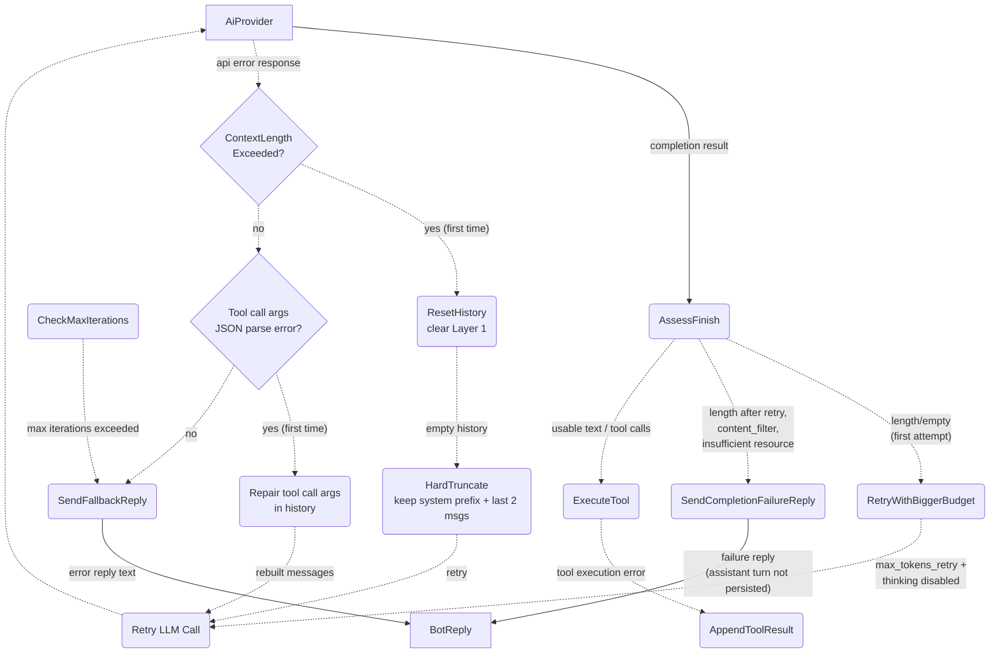

# Error Handling & Fallbacks

## 1. Purpose

Descends from [the agent loop](../agent-loop.md): how API errors, tool execution
errors, and iteration-limit breaches lead to context reset/repair retries or a
fallback error reply. It also covers **HTTP 200 but unusable completions** — a
`finish_reason = "length"` (truncated/empty, e.g. reasoning tokens consuming the
whole output budget) or `content_filter` / `insufficient_system_resource`
completion is retried once with a larger budget, then answered with a distinct
failure reply and **not** persisted as an assistant turn (issue #117).

**References:**
- [Agent Loop (Main Success Path)](../agent-loop.md) — parent Level 1 flow
- [Context-Length-Exceeded Retry](./context-length-retry.md) — `ContextLengthExceeded` reset/retry path
- [Tool-Call JSON Parse Error Recovery](./tool-call-repair.md) — tool-call args parse error repair path

## 2. Diagram

### Finish-reason assessment

| `finish` | Text | Action |
| -------- | ---- | ------ |
| `length` | any (first attempt) | Retry once with `max_tokens_retry` (clamped to 3/4 of `model_context_length`) and `thinking: disabled` when the provider supports it; nothing is persisted from the discarded attempt. |
| `length` | non-empty (after retry) | Accept the reply with a `warn!` "truncated reply accepted" log. |
| `length` | empty (after retry) | Budget-exhaustion reply; no assistant turn is persisted. |
| `content_filter` / `insufficient_system_resource` | any | Distinct failure reply; no assistant turn is persisted. |
| `stop` / `error` | empty | One retry, then the generic "incomplete response" reply. |
| `tool_calls` + `length` | — | `warn!` (arguments may be clamped); tool-call repair still applies. |
