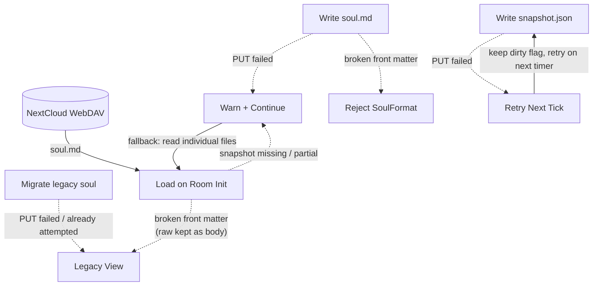

# Error Handling

## 1. Purpose

Failure paths for snapshot persistence, soul reads/writes, legacy soul
migration, and room-init loads: failed snapshot writes keep the dirty flag and
retry on the next timer tick; failed soul writes warn and continue; a failed
legacy migration falls back to the legacy in-memory view; broken front matter
is rejected on write but preserved verbatim on read.

References: ../restore-room.md, ../soul-editing.md

## 2. Diagram

