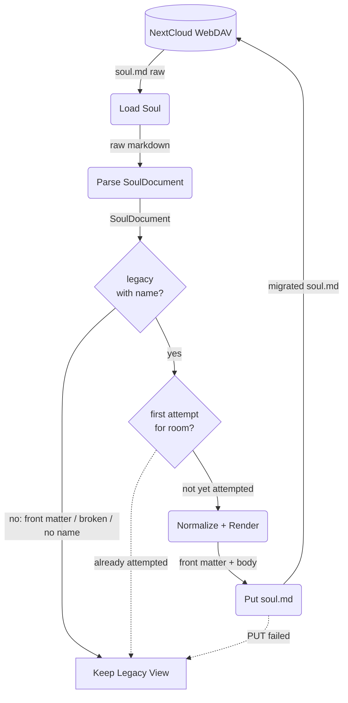

# Legacy Soul Migration

## 1. Purpose

On load, a legacy `soul.md` (no front matter, `- My name is X` bullet) is
rewritten once into the front-matter format: the identity bullet moves into
`name:`, and `schema` / `updated` are stamped by the bot.

References:
- [Retrieve from Two Layers](../retrieve-two-layers.md) — parent load flow
- [Soul Editing](../soul-editing.md) — the other write path (tool-driven)
- [Shared Structures](../structures.md) — `SoulMemory`, `SoulDocument`, `SoulFrontMatter`

## 2. Diagram

Notes:

- `MIGRATE` removes only the exact `- My name is <name>` line; the name itself
  is preserved in `name:`, so no persona text is lost.
- `KEEP` returns the parsed legacy view unchanged (derived `name` still usable)
  and the prompt keeps the legacy bullet.
- The attempt guard is `MemoryManager::soul_migration_attempted`, cleared when
  the room is evicted.
