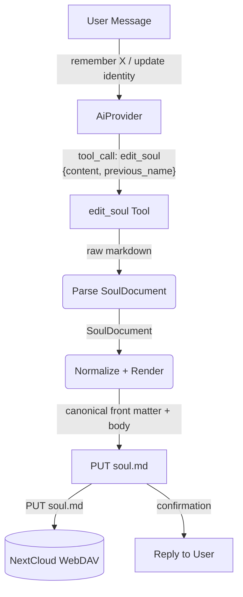

# Soul Editing

## 1. Purpose

When the user asks to remember something or update the persona in chat, the
LLM invokes the `edit_soul` tool with the full soul document as `content`. The
tool parses it, normalizes it (derives a missing `name` from the legacy bullet
or the harness-injected `previous_name`, stamps `schema`/`updated`), renders the
canonical form, overwrites `soul.md` on WebDAV and confirms to the user.

References:
- [Legacy Soul Migration](level-2/legacy-soul-migration.md) — load-time upgrade
  path for souls without front matter
- [Shared Structures](structures.md) — `SoulDocument`, `SoulFrontMatter`

## 2. Diagram

Broken front matter is rejected before `WRITE` (`SoulFormat` error, nothing
written) so the LLM can retry.

## 3. Data Structures

Shared data structures for these flows are documented in
[`structures.md`](structures.md) — see its `## 1. Overview` for
the subsystem context.
