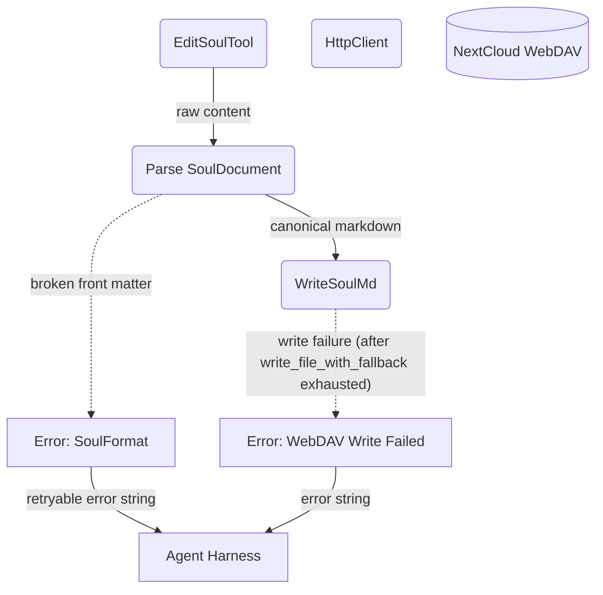

# Error Handling & Fallbacks

## 1. Purpose

Front matter is validated before any write: a `---` block that does not parse as
flat `key: value` lines is rejected with `RockBotError::SoulFormat` and no PUT
is issued, so the LLM can retry instead of silently destroying metadata. On
transport failure the tool relies on the underlying `write_file_with_fallback`
(AutoMkcol → mkcol parents → retry PUT); errors bubble up directly via `?`. See
the [happy path](../main-path.md).

## 2. Diagram

