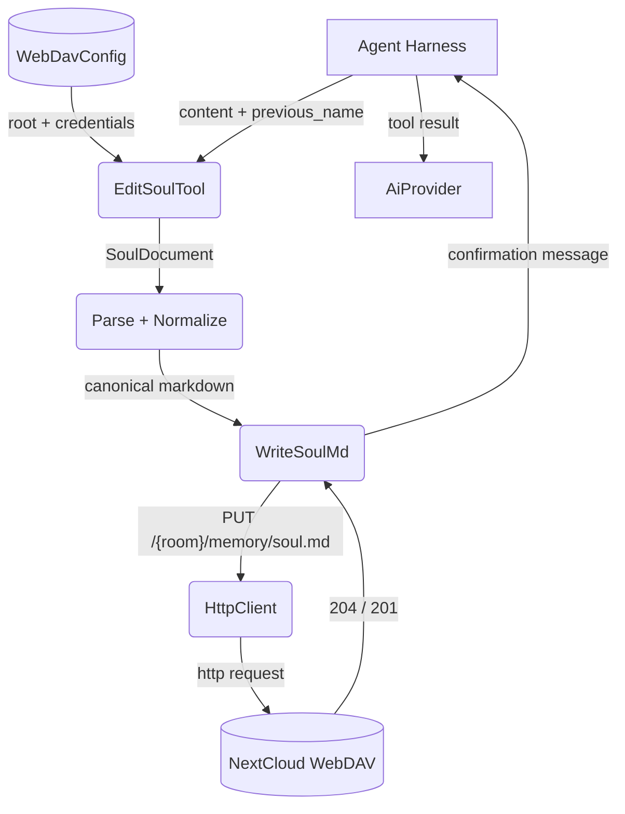

# Happy Flow (Main Success Path)

## 1. Purpose

Manages the bot's permanent per-room "soul" memory — a single `soul.md` file
stored on WebDAV under `{room}/memory/soul.md`. The tool performs a **full
replace** of the entire file content using the standard soul template.

The LLM uses this template (front matter optional):

```markdown
---
name: YourName ✨
address_user_as: Master 🐵
language: en
---

# Soul Memory

- (optional preference)
- (optional fact)
```

The body is a **flat enumeration list** — each line is a `-` bullet item, no
sub-headings. `name` is single-line, max 32 characters, no markdown.
`schema`/`updated` are bot-stamped, never authorable. Legacy souls (`- My name
is X` with no front matter) are migrated on write: the identity bullet moves
into `name:`. Broken front matter is rejected with `SoulFormat` and nothing is
written.

- Upstream: [Configuration Management](../../infra/config/main-path.md) provides WebDAV
  credentials for file access
- Upstream: [Agent Harness](../../agent/agent-harness/agent-loop.md) invokes `EditSoulTool` with
  the full soul content and injects `previous_name`
- Downstream: [WebDAV Tool](../webdav/main-path.md) performs the PUT operation
- Downstream: [Memory Management](../../memory/memory/soul-editing.md) — soul.md lives alongside
  other per-room memory archives under `{room}/memory/`

## 2. Diagram


