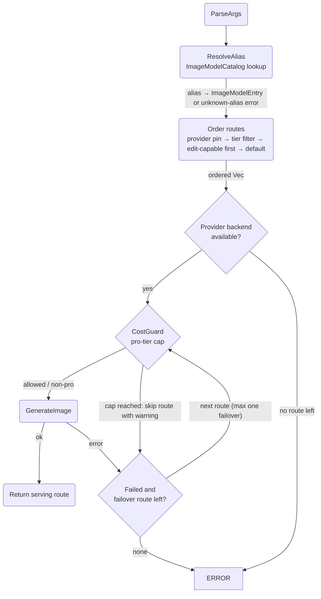

# Model & Provider Selection

## 1. Purpose

Level 2 detail for the happy-path diagram in [main-path](../main-path.md): how
the tool resolves the LLM's optional `model` alias against the manifest catalog
(`models/image.toml`, issues #111/#112), orders the alias's provider routes, and
picks the t2i or edit slug per route (issue #100). The manifest is the single
source of truth for aliases — `[[image_providers]]` only supplies credentials
and endpoints, and code never re-declares model ids.

## 2. Diagram

## 3. Catalog and routes

`ImageModelCatalog` is built once at registry time:

1. `image_manifest::load_catalog()` parses the embedded `models/image.toml`
   (or `[image_model] manifest_path` when set) and validates it: non-empty
   roster, ≥1 route per alias, unique aliases, exactly one `default = true`
   alias, ≤1 default route per alias, deprecated ≠ default. A malformed
   manifest aborts boot (`RockBotError::Config`) — a typo must not become a
   silent 404 at call time.
2. `main.rs` builds one backend per supported `[[image_providers]]` entry
   (`fal` / `openrouter`) and prunes routes whose provider has no usable
   backend, so the schema never advertises an unreachable provider.
3. The tool's `default_backend` is the manifest default alias's default route
   provider.

`ImageModelEntry` = one alias with an ordered `Vec<ImageRoute>`:

| Field        | Type              | Description                                              |
| ------------ | ----------------- | -------------------------------------------------------- |
| `alias`      | `string`          | LLM-facing selection name (`gptimage`, `qwenimage`, …).  |
| `label`      | `string`          | Human-facing name (`GPT Image 2.6 · Flare`).             |
| `family`     | `string`          | Model family (`openai`, `google`, `qwen`, …).            |
| `version`    | `string`          | Family version (`2.6`, `2.1`, …).                        |
| `deprecated` | `bool`            | Kept one release cycle; still selectable, marked in the description. |
| `routes`     | `[ImageRoute]`    | Ordered provider routes; preferred (`is_default`) first. |

`ImageRoute`:

| Field               | Type          | Description                                                     |
| ------------------- | ------------- | --------------------------------------------------------------- |
| `provider_name`     | `string`      | Owning `[[image_providers]]` entry name — selects the backend.   |
| `generate_model_id` | `string`      | Text-to-image slug.                                             |
| `edit_model_id`     | `Option<string>` | Dedicated edit slug; `None` ⇒ generate-only route (never a broken reference). |
| `tier`              | `ImageTier`   | `standard` / `pro` / `turbo` / `flash`.                          |
| `is_default`        | `bool`        | Preferred route of the alias (first when none is flagged).       |

Route selection (`ImageModelEntry::route_candidates`):

1. Filter by `provider` when the LLM pinned one.
2. Filter by `tier` when the LLM requested one.
3. Sort the preferred (`is_default`) route first.
4. For edit calls, stable-sort routes with an `edit_model_id` ahead of
   generate-only routes. An alias that only has generate-only routes still
   edits via its generate slug (same-model editing, #100).

An empty candidate list is a `ToolCallParse` error naming the alias's routed
providers and tiers — never a generic failure.

## 4. Execution and failover

- The tool uploads data URIs through the **primary** candidate's backend before
  the attempts (fal needs CDN URLs, OpenRouter accepts data URIs).
- Each attempt sets `params.model_id` to the route's mode-appropriate slug.
- A failed attempt logs `route <provider>:<model> failed (…) — failing over to
  <provider>:<model>` and advances to the next candidate **once** (at most two
  attempts, issue #112). Silent failover is forbidden: the result carries
  `provider`, `model`, and `tier` of the route that actually served the image.
- Text-to-image-only models (`ImageModelTraits`, #104) fail at the parse
  boundary before any provider request; the failover loop also skips such a
  route if another candidate could serve the edit.

## 5. Cost guardrail

Pro-tier routes are charged to the room's daily budget before the call
(`ProTierUsage`, UTC day rollover):

- `[image_model] pro_daily_cap` (default `20`, `0` disables) caps pro-tier
  generations per room per day. Reaching the cap skips the pro route with a
  warning (a non-pro route can still serve the call); when no candidate
  remains the tool returns a `ToolCallParse` error naming the cap.
- Every successful call writes a ledger line:
  `image_gen ledger room=… provider=… model=… tier=… img2img=… elapsed_ms=…`.
  There is no per-model pricing table in this repo — `tier` is the cost proxy.

## 6. Manifest roster (2026-11-05)

All slugs were verified against `GET https://openrouter.ai/api/v1/images/models`
and the fal model registry. Selected entries:

| alias            | routes (provider: generate / edit)                                            | tier |
| ---------------- | ----------------------------------------------------------------------------- | ---- |
| `gptimage` (default) | openrouter: `openai/gpt-image-2.6-flare` · fal: `openai/gpt-image-2.6/flare/{text-to-image,edit}` | standard |
| `sunburst`       | openrouter: `openai/gpt-image-2.6-sunburst` · fal: `openai/gpt-image-2.6/sunburst/{text-to-image,edit}` | standard |
| `banana`         | fal: `google/nano-banana-2.1{/edit}` · openrouter: `google/gemini-nano-banana-2.1` | standard |
| `qwenimage`      | openrouter: `qwen/qwen-image-2.1-pro` (default) / `qwen/qwen-image-2.1-turbo` | pro / turbo |
| `qwen3`          | openrouter: `qwen/qwen-image-3-pro`                                            | pro |
| `mai2pro`        | openrouter: `microsoft/mai-image-2.6`                                          | pro |
| `mai2flash`      | openrouter: `microsoft/mai-image-2.6-flash`                                    | flash |
| `grok2`          | openrouter: `x-ai/grok-imagine-image-2.0` · fal: `xai/grok-imagine-image/v2.0/{text-to-image,edit}` | standard |
| `seedream`       | fal: `fal-ai/bytedance/seedream/v4.5/text-to-image` · openrouter: `bytedance-seed/seedream-4.5` | standard |
| `seedream5`      | fal: `bytedance/seedream/v5/pro/{text-to-image,edit}`                          | standard |
| `seedream5pro`   | openrouter: `bytedance-seed/seedream-5-0-pro`                                  | standard |
| `seedream5flash` | fal: `bytedance/seedream/v5/flash/{text-to-image,edit}`                        | flash |
| `fibo`           | fal: `bria/fibo-2/{generate,edit}`                                             | standard |
| `moss`           | fal: `fal-ai/moss-image` (generate-only)                                       | standard |
| `muse`           | openrouter: `meta/muse-image` · fal: `meta/muse-image/{text-to-image,edit}`    | standard |
| `ming`           | openrouter: `inclusionai/ming-image-0.1-design` (generate-only)                | standard |
| `gptimage25`, `sunburst25` | deprecated 2.5 routes (kept one release, `#111`)                     | standard |

`gptimage`/`sunburst` moved 2.5 → 2.6; the old aliases remain as `gptimage25` /
`sunburst25` with `deprecated = true` so rooms pinned to 2.5 keep working.
`qwenimage` now defaults to 2.1 Pro with an opt-in turbo route; the former
`qwen-image-3-pro` default stays selectable as `qwen3`. `mai2flash` and
`seedream5flash` are the flash-tier aliases; `qwenimage` is the only alias with
an in-alias tier split (`tier="turbo"`).

`ming` (issue #104) remains text-to-image only and self-sized (see
[aspect-ratio.md](aspect-ratio.md)). Its route is generate-only; an edit call
fails at the parse boundary with a `ToolCallParse` error before selecting a
backend.

## 7. Provider differences

| Aspect | fal.ai | OpenRouter |
|--------|--------|------------|
| `upload_file()` | Initiate + PUT to CDN → file_url | Base64-encode → data URI |
| `generate_image()` | Submit → Poll → Fetch CDN → Download | Catalog-aware routing → single POST → parse base64 response |
| Image delivery | CDN URL → separate HTTP GET | Base64 inline in response JSON |
| Protocol | 3-phase async (submit/poll/fetch) | Single synchronous POST |
| Size param | `image_size` object; fibo `aspect_ratio`; nano-banana `aspect_ratio` + `resolution` (`FalSizeParam`) | catalog `aspect_ratio` + `resolution` caps |

fal requires CDN-hosted URLs (data URIs uploaded first), OpenRouter accepts
inline base64. The harness is unaware of this difference — both implement
`ImageProvider::generate_image() -> Vec<u8>`.

OpenRouter routing detail: pure image models (present in the OpenRouter image
catalog) go to the dedicated Image API `POST /images`; models absent from the
catalog fall back to `chat/completions`. See
[AI Provider §2d](../../../ai/ai-provider/level-2/openrouter-image-routing.md).
