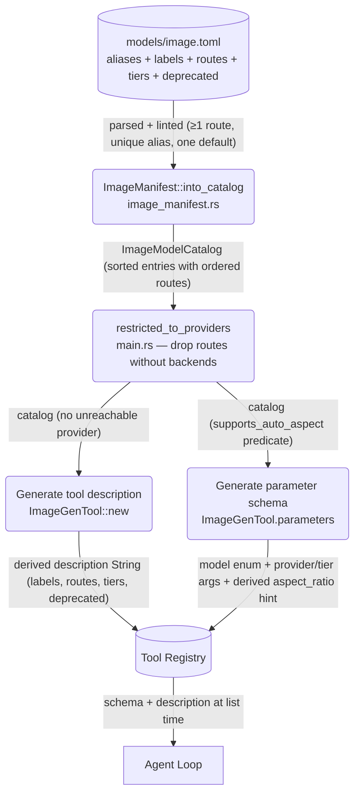

# Tool Description Generation

## 1. Purpose

Level 2 detail for the happy-path diagram in [main-path](../main-path.md): how
the `image_gen` tool's description and parameter schema are **generated from the
manifest** (`models/image.toml`) at registry time — the manifest is the single
source of truth for aliases, labels, routes, tiers, and deprecation (issues
#95/#111/#112). Nothing model-specific is hardcoded: adding, renaming, or
removing a manifest entry changes the LLM-visible description automatically.

## 2. Diagram

## 3. Derived text

| Output           | Derived from                                                    | Drift risk (if hardcoded) |
| ---------------- | --------------------------------------------------------------- | ------------------------- |
| Tool description | every entry's alias + label + ordered routes (provider:slug, edit slug, non-standard tier) + deprecated marker, default alias, `supports_auto_aspect` | stale model names (e.g. 2.5 after a 2.6 bump), wrong provider routing hint, unmarked deprecated aliases |
| Tier guidance    | one fixed line (`turbo`/`flash` = drafts, `pro` = final output) | paying pro rates for sketches (#112) |
| Failover note    | one fixed line: one failover step, serving provider/model reported | silent failover hiding a dead provider |
| `model` param description | valid alias list, default alias | enum/description mismatch |
| `model` param `enum` | `allowed_aliases()` (sorted; omitted when manifest empty) | LLM picks an alias that no longer exists |
| `provider` param | free-form pin; no enum (providers can vary by deployment) | hardcoded provider list drifting from `[[image_providers]]` |
| `tier` param `enum` | fixed `standard`/`pro`/`turbo`/`flash` | — |
| `aspect_ratio` param description | `supports_auto_aspect` (any route slug containing `seedream/v5`) | auto-dimensional hint absent/present wrongly |

Deprecated aliases stay in the enum (old rooms keep working) but are appended to
the description as `Deprecated aliases (still accepted; prefer the
replacement): …`.

The `supports_auto_aspect` predicate reuses the same `seedream/v5` model-id
marker as `FalAiProvider` (see [AI Provider](../../../ai/ai-provider/main-path.md) /
`fal.rs` request builder) so the description hint and the provider's body
generation can never disagree about which models accept `auto_1K`/`auto_2K`.
