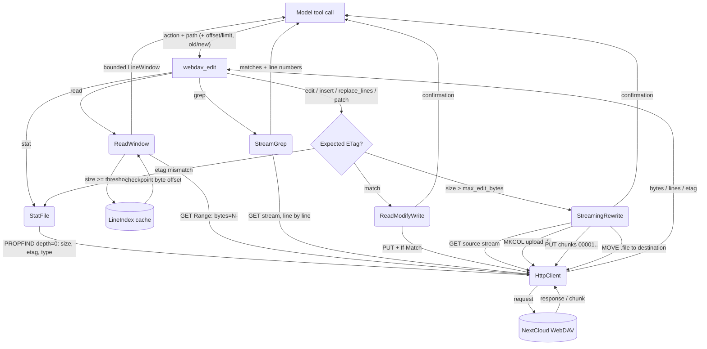

# WebDAV — Large-File Edit

## 1. Purpose

Happy flow of the `webdav_edit` tool: a large UTF-8 text file (for example a
million-line SVG) is read in bounded windows, searched without loading it whole,
and edited through a unique-match, etag-guarded write. Files above
`max_edit_bytes` are transformed while streaming and uploaded through Nextcloud
chunked upload v2, so memory stays bounded by one chunk.

The room-scoped path resolution and sanitization rules are shared with the
main path; see [main-path.md](main-path.md) and
[structures.md](structures.md).

## 2. Diagram

## 3. Flow notes

1. **Stat first.** Every action starts with a depth-0 PROPFIND to obtain size,
   etag, content type and whether the target is a directory. The etag is
   remembered per path.
2. **Text check.** `.svg`, `.xml`, `.json`, source extensions and `text/*` /
   `*xml*` / `*json*` content types are accepted; otherwise the first 8 KiB are
   probed for NUL bytes or invalid UTF-8 and binary files are rejected.
3. **Windowed read.** `read` requests a 1-based `offset` and a capped `limit`
   (default/max 2000 lines, 64 KiB, 2000 chars per line). Files at or above
   `stream_threshold_bytes` build (once per `path+etag+size`) a sparse
   `LineIndex`; subsequent reads start at the nearest checkpoint byte and use an
   HTTP `Range` request. Files without newlines use `byteOffset`/`byteLimit`.
4. **Grep.** A streamed regex scan returns `line: text` matches with optional
   context; memory is bounded and the scan stops at `maxMatches`.
5. **Guarded mutation.** `edit` requires a unique literal match unless
   `replaceAll`; `insert` addresses a line boundary; `replace_lines` replaces an
   inclusive range; `patch` applies several literal hunks in one pass. A
   supplied or remembered etag is compared before the write, and small writes
   send `If-Match`.
6. **Streaming rewrite.** Above `max_edit_bytes`, the source is read as a
   stream, transformed in memory one chunk at a time, uploaded as 5 MiB chunks
   to `uploads/{user}/{transfer-id}`, and assembled with a final `MOVE`. A
   second match aborts the upload and deletes the chunk directory when
   `replaceAll` is false. Large `patch` calls run one streaming rewrite per
   hunk.
7. **No rollback.** A failed streaming rewrite aborts and deletes the upload
   directory; a completed `MOVE` is the commit point. As in the main path, the
   tool never buffers the whole file for the large branch.

## 4. Error paths

| Condition | Result |
| --- | --- |
| `expectedEtag` differs from server etag | `cannot modify ...: file changed since it was read ... re-read the file, then retry` |
| `oldString` absent | `oldString not found ... re-read the file and retry` |
| `oldString` matches > 1 (no `replaceAll`) | error listing match line numbers (small) or abort with multiple-match (streaming) |
| `startLine`/`line` beyond EOF | `LineOutOfRange` |
| line range inverted or `line == 0` | parameter error |
| endpoint has no `/files/` prefix (no chunked upload) | `ChunkedUploadUnsupported`: use insert/replace_lines or a Nextcloud target |
| binary target | `webdav_edit handles UTF-8 text files only` |
