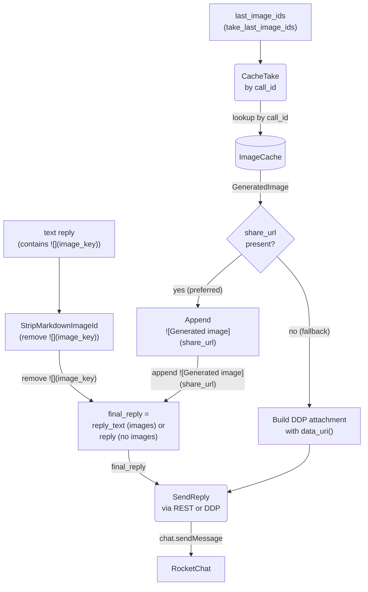

# Generated Image Sharing via NextCloud Share Links

## 1. Purpose

The `image_gen` tool creates a NextCloud public share link (7-day expiry)
during tool execution and stores it in `ImageCache`. The harness records the
call IDs in `last_image_ids` and returns the LLM's reply text with the
`image_key` placeholder still intact — **the harness does not modify the
reply text for images**. After `process_message()` returns, the agent loop
(main.rs) retrieves the IDs, takes images from the cache, replaces the
placeholder with the share URL markdown, and sends the final message.

**References:**
- [Agent Loop (Main Success Path)](./agent-loop.md) — `process_message()` and post-reply main.rs handling
- [Image Interception for Editing](./image-interception.md) — `ImageCache` `ImageGenTool` result handling
- [Image Generation](../../tools/image-gen/) — `create_nextcloud_share_link()` provider
- [WebDAV](../../tools/webdav/) — persistence of the uploaded image before sharing

## 2. Diagram

**Harness role** (`process_message`): tracks `image_ids_this_turn` during
the agent loop, stores them in `last_image_ids` before returning, and exposes
them via `take_last_image_ids()`. Returns the LLM's reply text unmodified —
the `image_key` placeholder is still present for main.rs to replace.

**ImageGenTool role**: calls `create_nextcloud_share_link()` on `WebDavClient`
right after WebDAV upload — `POST /ocs/v2.php/apps/files_sharing/api/v1/shares`
with `shareType=3`, `permissions=1`, `expireDate={today+7d}`. Stores the
result (with `/download` suffix for direct raw image access) as
`GeneratedImage.share_url`. Stores the entire `GeneratedImage` in `ImageCache`
keyed by `call_id`.

**Agent loop role** (main.rs): after `process_message()` returns, calls
`take_last_image_ids()` to get the call IDs, then `take_image()` for each one.
If `share_url` is present, appends ``
(the URL already carries the `/download` suffix) to the reply text and strips
the original `` markdown.
If `share_url` is `None`, falls back to a DDP attachment with `data_uri()`.
Uses `final_reply` (the modified text or original) for the outgoing message.

**Fallback**: if share generation fails (`share_url` is `None`), the agent loop
builds a DDP `sendMessage` with a `data:` URI in the `attachments` field, using
`GeneratedImage::data_uri()`. This is a worst-case path for when NextCloud's
sharing API is unavailable.

**Design rationale**: NextCloud share URLs are short — the `/download` endpoint
returns raw image bytes with correct `Content-Type` for inline rendering in
RocketChat. This eliminates both the `Message_MaxAllowedSize` REST limit
(short URL, no base64 in msg text) and the DDP attachments schema restriction
(Match failed [400]). Share links expire after 7 days, longer than typical
chat message lifetimes.

**SVG (`share_image`, issues #120/#122)**: images already stored in WebDAV are
shared by the `share_image` tool rather than `image_gen`. Since 2026-11-06 the
instance returns `image/svg+xml` from `{share}/download` (after
`config/mimetypemapping.json` + `occ maintenance:mimetype:update-db`), so the
tool probes `/download` once and uses that response body directly when it is
`2xx` + `image/svg+xml`. This keeps the vector (CSS/SMIL animation) and avoids
a WebDAV re-read. If `/download` returns `text/plain`,
`application/octet-stream`, a non-2xx status, or a transport failure, the tool
falls back to `{share}/preview`, validates `2xx` + `image/*`, and stores the
rasterized PNG bytes. The reply pipeline is unchanged: `main.rs` appends the
chosen URL as markdown exactly like an `image_gen` `/download` URL.
PNG/JPEG/GIF/WebP inputs keep the `/download` path and original bytes. The
harness injects `image_cache_key` into `share_image` arguments and queues its
call id in `last_image_ids`, just like `image_gen`.

**Probe (2026-11-06, share `apJsNRMeGggHd2n`)**: `GET /download` → `303` → `200`,
`image/svg+xml`, 7,254 B, `Content-Disposition: attachment`; `GET /preview` →
`200`, `image/png`, 77,528 B (`800-600-max.png`). The vector is ~10× smaller
than its preview. CSP `default-src 'none'` on the download response does not
block `<style>`/`style=` or CSS animations when the SVG is rendered in an
`` or CSS background image (checked in Firefox; Chromium has historically
not enforced CSP for SVG images). Content-Disposition is irrelevant for
subresource rendering; clicking the link still downloads.

**Suffix choice (probed, issue #97)**: on paper `/preview`
(`PublicPreviewController::directLink`) looks superior — HTTP 200 directly,
real MIME type (`image/png`), `Content-Disposition: inline`, 24h cache — while
`/download` responds 303 to `public.php/dav/files/{token}` with
`Content-Disposition: attachment`. Production testing showed the opposite:
RocketChat failed to render `/preview` URLs inline despite correct headers,
while `/download` renders fine. The suffix was switched to `/preview` and then
reverted back to `/download`. Caveat: when Imaginary is enabled server-side,
`/preview` may serve a downscaled rendition rather than original bytes.
