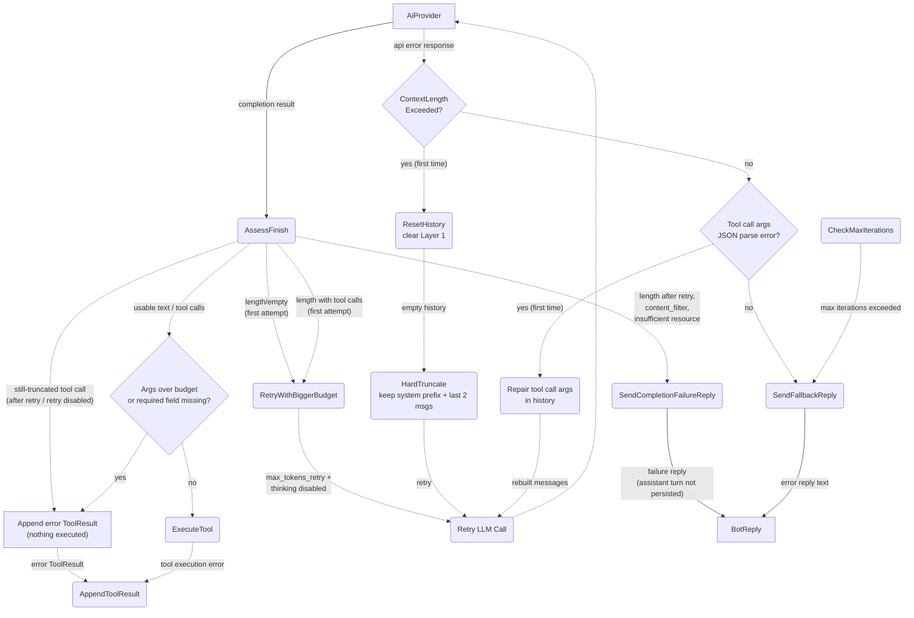

# Error Handling & Fallbacks

## 1. Purpose

Descends from [the agent loop](../agent-loop.md): how API errors, tool execution
errors, and iteration-limit breaches lead to context reset/repair retries or a
fallback error reply. It also covers **HTTP 200 but unusable completions** — a
`finish_reason = "length"` (truncated/empty, e.g. reasoning tokens consuming the
whole output budget) or `content_filter` / `insufficient_system_resource`
completion is retried once with a larger budget, then answered with a distinct
failure reply and **not** persisted as an assistant turn (issue #117). A
truncated completion that carries **tool calls** follows the same retry, and a
still-truncated call is answered with an error `ToolResult` instead of being
executed (issue #110). Independently, every tool call is **pre-flighted**
against `Tool::max_arg_bytes()` and its schema's `required` fields before
execution; oversized or incomplete arguments are rejected with an actionable
message instead of reaching the tool.

**References:**
- [Agent Loop (Main Success Path)](../agent-loop.md) — parent Level 1 flow
- [Tool Execution Deep Dive](../tool-dispatch.md) — argument pre-flight and dispatch
- [Context-Length-Exceeded Retry](./context-length-retry.md) — `ContextLengthExceeded` reset/retry path
- [Tool-Call JSON Parse Error Recovery](./tool-call-repair.md) — tool-call args parse error repair path

## 2. Diagram

### Finish-reason assessment

| `finish` | Text | Action |
| -------- | ---- | ------ |
| `length` | any (first attempt) | Retry once with `max_tokens_retry` (clamped to 3/4 of `model_context_length`) and `thinking: disabled` when the provider supports it; nothing is persisted from the discarded attempt. |
| `length` | non-empty (after retry) | Accept the reply with a `warn!` "truncated reply accepted" log. |
| `length` | empty (after retry) | Budget-exhaustion reply; no assistant turn is persisted. |
| `content_filter` / `insufficient_system_resource` | any | Distinct failure reply; no assistant turn is persisted. |
| `stop` / `error` | empty or whitespace-only | One retry, then the generic "incomplete response" reply. |
| `tool_calls` + `length` | — | Same retry as an empty text completion, with nothing persisted or executed. If still truncated (or retrying is disabled), the assistant turn is appended with one error `ToolResult` per call and **nothing executes**; the loop then continues so the model can retry with smaller calls. |

### Tool-argument pre-flight

Every tool call is checked **before** room-context / image-URL injection, i.e.
on the raw model-written arguments:

- `arguments.len() > Tool::max_arg_bytes()` — 8 KiB by default;
  `webdav` / `webdav_edit` raise it to 64 KiB (large-content route) and
  `save_knowledge` to 32 KiB.
- the document must parse as a JSON object and contain every field listed in
  `parameters()["required"]`.

A failing call is not executed: the harness appends an error `ToolResult` that
names the tool, the byte length and limit, the largest field and its length,
and the actionable route — split the payload, or write it to WebDAV and pass
`file_from_webdav` (or chunk it with `webdav_edit`). This replaces the bare
`missing field ... at line 1 column 13963` serde message from the original
#110 report. A truncated tool call repaired by a provider's
`repair_tool_args` (`{}` fallback, partial strings) is caught by the
required-field / size checks; the `finish_reason = length` guard stops partial
writes even when the repaired arguments happen to look valid. See
[Tool-Call JSON Parse Error Recovery](./tool-call-repair.md) for the
provider-level repair path.

