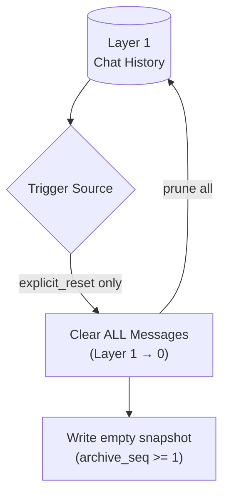

# Hard Reset Deep Dive (Explicit Reset Only)

## 1. Purpose

When triggered by `explicit_reset`, Layer 1 is cleared instantly — no LLM
call, no knowledge priority review. The empty history is then written to
WebDAV synchronously (`write_snapshot(force = true)`), bumping `archive_seq` so
a restart restores an empty history instead of the cleared one.

References: [Post-Reply Decision](../post-reply-decision.md),
[reset_memory Tool](../reset-memory-tool.md),
[Pre-LLM Shortcut](../pre-llm-shortcut.md).

## 2. Diagram

Hard reset is triggered exclusively by `explicit_reset`; the literal
`!reset`/`!clearmemory` shortcut runs it before replying, the `reset_memory`
tool path after the reply. Token and byte pressure flags route to LLM
summarization ([LLM Summarization Deep Dive](summarization.md)) instead. No
`summary.md` is created, read, or managed.
