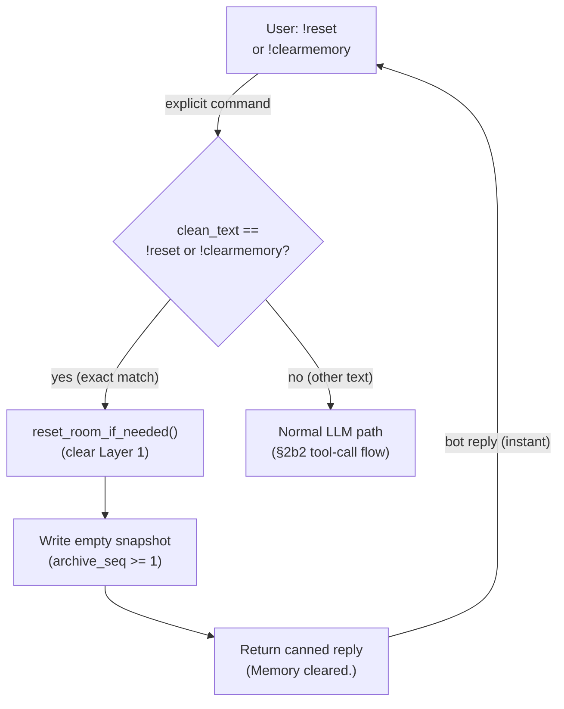

# Explicit Reset Shortcut — Pre-LLM Fast Path

## 1. Purpose

When the user sends a literal `!reset` or `!clearmemory` command (exact match
after trimming), the harness detects it **before the LLM call**, clears Layer 1,
writes the empty snapshot synchronously, and returns a canned reply. No LLM
round-trip, no tool call, no token cost, no restart window.

Natural-language reset requests ("clear my memory", "start fresh") still go
through the LLM tool-call path in the [reset_memory tool flow](reset-memory-tool.md)
— the model handles intent detection, and that path defers the reset to
post-reply.

References: [Hard Reset Deep Dive](level-2/hard-reset.md),
[reset_memory Tool](reset-memory-tool.md).

## 2. Diagram

**Latency**: near-zero — no provider call, no tool dispatch. The wipe plus one
WebDAV PUT happen before the reply. The `reset_memory` tool registration is
still needed for natural-language reset requests that the LLM handles via
intent detection.
