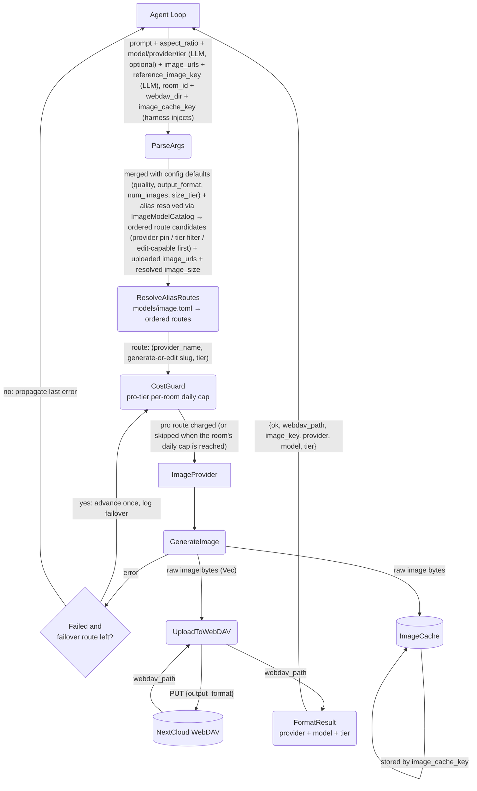

# Image Generation Tool

## 1. Purpose

Generates images via an `ImageProvider` (fal.ai queue API or OpenRouter
Image API / chat-completions fallback), stores them on WebDAV for persistence, and caches the
raw image bytes in the shared `ImageCache`. The agent loop calls `image_gen`
with a prompt and optional parameters; the tool delegates to the provider,
writes to WebDAV, stores to the cache, and returns a minimal result
(`{ok, webdav_path, image_key, provider, model, tier}`) so the LLM context stays
lightweight.

The model roster comes from `models/image.toml`, the canonical manifest embedded
at build time (`image_manifest.rs`, issues #111/#112). `[[image_providers]]`
only supplies credentials and endpoints — it no longer declares aliases. Each
alias owns an **ordered route list** (`[[model.route]]`): one route per provider,
with separate generate/edit slugs and an optional tier (`standard`/`pro`/
`turbo`/`flash`). The LLM selects an alias per call via `model`; omitting it uses
the manifest's `default = true` alias. Two optional args refine routing:
`provider` pins one route, `tier` picks a quality/speed route of the alias.

Per-model wire traits (issue #104, [structures.md](structures.md) §3
`ImageModelTraits`) shape the request beyond the catalog: the Ming Design model
id (`inclusionai/ming-image-0.1-design`) is **self-sized** (the provider omits
`resolution` / `aspect_ratio`, the tool returns a one-line `note` instead) and
**text-to-image-only** (an edit call carrying input images fails at the parse
boundary with a clear `ToolCallParse` error before any provider request). The
`ming` alias itself is not in the manifest roster; the traits remain
model-id driven. `FalSizeParam` additionally selects the fal size-param shape
per endpoint (`image_size` object vs `aspect_ratio`/`resolution`; see
[model-provider-selection.md](level-2/model-provider-selection.md)).

- Upstream: [Agent Harness](../../agent/agent-harness/image-interception.md) injects `room_id`, `webdav_dir`,
  and `image_cache_key` (call_id) into tool args before invoking `execute_by_name()`
- Upstream: [Image Injection Pipeline](../../agent/agent-harness/image-sharing.md)
  retrieves the image from ImageCache by key and uploads it as a RocketChat attachment
- Downstream: [Image Provider](../../ai/ai-provider/main-path.md) — `FalAiProvider` (CDN-hosted URLs)
  and `OpenRouterImageProvider` (inline base64) implement `generate_image() -> Vec<u8>`
- Downstream: WebDAV crate persists image assets
- Shared: `ImageCache` (`image_cache.rs`) is the central store keyed by call_id

## 2. Diagram

## 3. Data Structures

Shared with [structures.md](structures.md).
